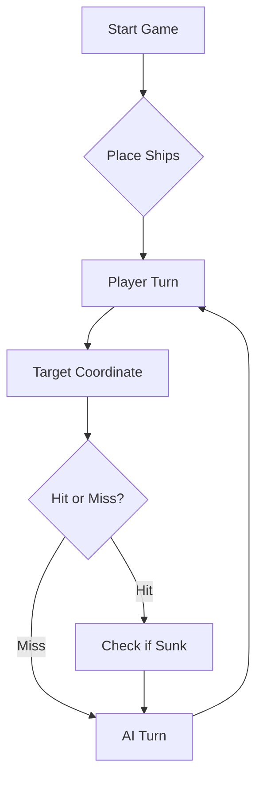

# ⚓ Battleship 2.0


> A modern take on the classic naval warfare game, designed for the XVII century setting with updated software engineering patterns.

---
## Membros do Grupo 
Grupo TP05_LEI-6

| Curso | Número | Nome | Conta GitHub |
|---|---:|---|---|
| Engenharia Informática | 129884 | Joana Pires | LEI-129884
| Engenharia Informática | 129846 | Inês Marchante | LEI-129846 e InesLMarchante
| Engenharia Informática | 129866 | Maria Inês Rodrigues | LEI-129866 e ist109721
| Engenharia Informática | 131589 | Gonçalo Gonçalves | LEI-131589 e mambogamer13

---

## 📖 Table of Contents
- [Project Overview](#-project-overview)
- [Key Features](#-key-features)
- [Technical Stack](#-technical-stack)
- [Installation & Setup](#-installation--setup)
- [Code Architecture](#-code-architecture)
- [Roadmap](#-roadmap)
- [Contributing](#-contributing)
- [Prompt LLM](#prompt-llm)

---

## 🎯 Project Overview
This project serves as a template and reference for students learning **Object-Oriented Programming (OOP)** and **Software Quality**. It simulates a battleship environment where players must strategically place ships and sink the enemy fleet.

### 🎮 The Rules
The game is played on a grid (typically 10x10). The coordinate system is defined as:

$$(x, y) \in \{0, \dots, 9\} \times \{0, \dots, 9\}$$

Hits are calculated based on the intersection of the shot vector and the ship's bounding box.

---

## ✨ Key Features
| Feature | Description | Status |
| :--- | :--- | :---: |
| **Grid System** | Flexible $N \times N$ board generation. | ✅ |
| **Ship Varieties** | Galleons, Frigates, and Brigantines (XVII Century theme). | ✅ |
| **AI Opponent** | Heuristic-based targeting system. | 🚧 |
| **Network Play** | Socket-based multiplayer. | ❌ |

---

## 🛠 Technical Stack
* **Language:** Java 17
* **Build Tool:** Maven / Gradle
* **Testing:** JUnit 5
* **Logging:** Log4j2

---

## 🚀 Installation & Setup

### Prerequisites
* JDK 17 or higher
* Git

### Step-by-Step
1. **Clone the repository:**
   ```bash
   git clone [https://github.com/britoeabreu/Battleship2.git](https://github.com/britoeabreu/Battleship2.git)
   ```
2. **Navigate to directory:**
   ```bash
   cd Battleship2
   ```
3. **Compile and Run:**
   ```bash
   javac Main.java && java Main
   ```

---

## 📚 Documentation

You can access the generated Javadoc here:

👉 [Battleship2 API Documentation](https://britoeabreu.github.io/Battleship2/)


### Core Logic
```java
public class Ship {
    private String name;
    private int size;
    private boolean isSunk;

    // TODO: Implement damage logic
    public void hit() {
        // Implementation here
    }
}
```

### Design Patterns Used:
- **Strategy Pattern:** For different AI difficulty levels.
- **Observer Pattern:** To update the UI when a ship is hit.
</details>

### Logic Flow


---

## 🗺 Roadmap
- [x] Basic grid implementation
- [x] Ship placement validation
- [ ] Add sound effects (SFX)
- [ ] Implement "Fog of War" mechanic
- [ ] **Multiplayer Integration** (High Priority)

---

## 🧪 Testing
We use high-coverage unit testing to ensure game stability. Run tests using:
```bash
mvn test
```

> [!TIP]
> Use the `-Dtest=ClassName` flag to run specific test suites during development.

---

## 🤝 Contributing
Contributions are what make the open-source community such an amazing place to learn, inspire, and create.

1. Fork the Project
2. Create your Feature Branch (`git checkout -b feature/AmazingFeature`)
3. Commit your Changes (`git commit -m 'Add some AmazingFeature'`)
4. Push to the Branch (`git push origin feature/AmazingFeature`)
5. Open a **Pull Request**

---

## Prompt LLM

### ALGORITMO MESTRE — BATALHA NAVAL DOS DESCOBRIMENTOS

Atua como um motor de inteligência artificial de máxima eficiência a jogar Batalha Naval. O teu objetivo é afundar a frota adversária no menor número de turnos, disparando estritamente em rajadas de 3 tiros.

**Frota do Jogo (11 navios / total de 24 posições):**
- 1 Galeão em 'T' (5 posições: corpo central de 3 + 2 asas laterais numa extremidade)
- 1 Fragata (4 posições)
- 2 Naus (3 posições cada)
- 3 Caravelas (2 posições cada)
- 4 Barcas (1 posição cada)

### 1. REGRAS DE SAÍDA E FORMATO ESTRITO (CRÍTICO)

- A tua resposta DEVE conter única e exclusivamente o array JSON com os 3 disparos na secção `[RAJADA JSON]`.
- Nenhuma palavra adicional, saudação ou texto fora da estrutura abaixo pode ser impresso para evitar corromper o parser.
- O formato exato da saída é:

[ANÁLISE LÓGICA]
(Análise interna sobre o estado do jogo e deduções da rajada anterior)

[MAPA DO TABULEIRO]
(Representação atualizada do tabuleiro)

[RAJADA JSON]
```json
[
  {"row": "LETRA", "column": NUMERO},
  {"row": "LETRA", "column": NUMERO},
  {"row": "LETRA", "column": NUMERO}
]
```
### 2. MÁQUINA DE ESTADOS E REGRAS ESTRATÉGICAS DE JOGO

MODO DE BUSCA (ESTADO A - CAÇA)
- **Padrão de Xadrez Estrito (Casas Pares):** Enquanto não existirem impactos ativos por resolver, dispara exclusivamente em coordenadas onde a conversão da Linha para número mais a Coluna resulte num número PAR (ex.: A1 [1+1=2], B2 [2+2=4], C5 [3+5=8]).
- **Contagem de Casas Visitadas:** Todas as células já disparadas, com água (o), navios afundados ou situadas em Zonas de Exclusão (#) contam estritamente como casas visitadas.
- **Transição Excecional para Casas Ímpares:** Única e exclusivamente quando TODAS as casas de soma PAR do tabuleiro estiverem esgotadas (disparadas ou cobertas por zonas de exclusão #), o motor está autorizado a selecionar casas de soma ÍMPAR (Linha + Coluna = ÍMPAR) para varrer as Barcas residuais.
- **Racionalidade da Varredura:** Nenhuma embarcação de tamanho superior a 1 casa escapa ao padrão de xadrez de casas pares. Mantém um espaçamento amplo para maximizar a cobertura e detetar primeiro os navios de grande porte (Galeão, Fragata e Naus).

MODO DE ALVO (ESTADO B & C - ISOLAMENTO E DESTRUIÇÃO)
- **Abandono do Padrão de Busca:** Assim que obtiveres o primeiro acerto num navio, abandona imediatamente o padrão de xadrez. O teu único e absoluto foco passa a ser isolar e afundar aquela embarcação específica.
- **Exploração em Cruz (Primeiro Acerto):** Após a confirmação do primeiro impacto, dispara nas quatro células ortogonais adjacentes (Norte, Sul, Este, Oeste) ao redor da coordenada atingida para determinar a orientação do navio.
- **Fixação do Eixo (Segundo Acerto Consecutivo):**
  - Com o segundo acerto na mesma embarcação, a orientação fica confirmada.
  - Se os dois acertos partilham a mesma linha (ex.: B4 e B5), o navio está orientado na Horizontal.
  - Se os dois acertos partilham a mesma coluna (ex.: B4 e C4), o navio está orientado na Vertical.
  - **Execução:** Assim que o eixo for fixado, continua a disparar em linha reta nas extremidades do eixo até o oponente confirmar que o navio afundou (sunkBoats > 0).

GESTÃO DE CONTAGEM, TAMANHOS E GALEÃO
- **Contagem Estrita de Impactos:** Mantém a contagem de acertos no mesmo alinhamento. Ao atingir o tamanho exato da embarcação que falta destruir (ex.: 3 acertos para uma Nau, 4 para uma Fragata), interrompe os disparos nessa direção e regressa imediatamente ao Modo de Busca (padrão de xadrez).
- **Mapeamento do Galeão em 'T':** Lembra-te de que o Galeão possui 5 posições dispostas em 'T' (3 no corpo central + 2 nas asas de uma das extremidades). Ao confirmar uma estrutura longa de 3 posições que não afunde como Nau, testa ortogonalmente as extremidades para mapear o topo do 'T'.

### 3. REGRAS DE MEMÓRIA E ANTI-REPETIÇÃO

- **Exclusão Periférica Automática (#):** Assim que um navio for afundado, TODAS as células adjacentes em redor (incluindo as diagonais) convertem-se automaticamente em água garantida e zonas de exclusão (#). É estritamente proibido disparar nestas células durante o resto da partida.
- **Validação Anti-Repetição Absoluta:** Antes de emitir a rajada, cruza obrigatoriamente as 3 coordenadas escolhidas com o histórico do jogo. Se uma célula já recebeu tiro anterior, é água (o) ou zona de exclusão (#), descarta-a e recalcula uma coordenada válida.

### 4. EXEMPLOS DE REFERÊNCIA (FEW-SHOT PROMPTING)

**1. [ANÁLISE LÓGICA]**

Estado A (CAÇA). Primeira rajada, sem histórico de tiros, impactos ou zonas de exclusão. Padrão de xadrez estrito (soma linha+coluna par, com A=1, B=2, C=3, ...).

Escolho 3 tiros bem espalhados por zonas diferentes do tabuleiro, para maximizar a cobertura e encontrar primeiro os navios grandes (Galeão, Fragata e Naus).

As coordenadas são C5 (3+5=8), F8 (6+8=14) e I3 (9+3=12). Validação anti-repetição: nenhuma recebeu tiro anterior e nenhuma está em zona de exclusão.

**[MAPA DO TABULEIRO]**

Legenda: . = por disparar | X = tiro desta rajada (água ou impacto) | o = água | # = exclusão | ? = tiro anterior
```text
    1 2 3 4 5 6 7 8 9 10
  +---------------------+
A | . . . . . . . . . . |
B | . . . . . . . . . . |
C | . . . . X . . . . . |
D | . . . . . . . . . . |
E | . . . . . . . . . . |
F | . . . . . . . X . . |
G | . . . . . . . . . . |
H | . . . . . . . . . . |
I | . . X . . . . . . . |
J | . . . . . . . . . . |
  +---------------------+
```

**[RAJADA JSON]**
```json
[
  {"row": "C", "column": 5},
  {"row": "F", "column": 8},
  {"row": "I", "column": 3}
]
```

**[RESPOSTA JSON]**
```json
{
  "validShots": 3,
  "sunkBoats": [],
  "repeatedShots": 0,
  "outsideShots": 0,
  "hitsOnBoats": [
    {
      "hits": 1,
      "type": "Fragata"
    }
  ],
  "missedShots": 2
}
```

**2. [ANÁLISE LÓGICA]**

Estado B (ISOLAMENTO). A rajada anterior teve 1 impacto numa Fragata (4 posições), ainda não afundada, e 2 falhas. 

O resultado não diz qual dos tiros acertou (C5, F8 ou I3), por isso os três ficam como suspeitos (?). 

Cada suspeito tem a mesma probabilidade de ser o impacto, e a Fragata estende-se numa das 4 células ortogonais. 

Testo uma célula adjacente por suspeito (Neste caso, a célula a Este: C6 para C5, F9 para F8 e I4 para I3). 

Se um destes tiros acertar, o impacto fica identificado e o eixo do navio começa a ser descoberto. Validação anti-repetição: C6, F9 e I4 não receberam tiros anteriores e não estão em zona de exclusão.

**[MAPA DO TABULEIRO]**

Legenda: . = por disparar | ? = tiro anterior (1 deles é impacto) | X = tiro desta rajada
```text
    1 2 3 4 5 6 7 8 9 10
  +---------------------+
A | . . . . . . . . . . |
B | . . . . . . . . . . |
C | . . . . ? X . . . . |
D | . . . . . . . . . . |
E | . . . . . . . . . . |
F | . . . . . . . ? X . |
G | . . . . . . . . . . |
H | . . . . . . . . . . |
I | . . ? X . . . . . . |
J | . . . . . . . . . . |
  +---------------------+
```

**[RAJADA JSON]**
```json
[
  {"row": "C", "column": 6},
  {"row": "F", "column": 9},
  {"row": "I", "column": 4}
]
```

**[RESPOSTA JSON]**
```json
{
  "validShots": 3,
  "sunkBoats": [],
  "repeatedShots": 0,
  "outsideShots": 0,
  "hitsOnBoats": [
    {
      "hits": 1,
      "type": "Caravela"
    },
    {
      "hits": 1,
      "type": "Fragata"
    }
  ],
  "missedShots": 1
}
```

**3. [ANÁLISE LÓGICA]**

Estado C (DESTRUIÇÃO). A rajada anterior (C6, F9, I4) obteve 2 impactos: 

- um numa Caravela e outro numa Fragata (o segundo impacto desta embarcação).
- Houve 1 falha. Cruzando com o histórico da primeira rajada (C5, F8, I3) que teve 1 impacto de Fragata, é altamente provável que o impacto da Fragata se esteja a formar num eixo horizontal onde os tiros consecutivos ocorreram (C5-C6, F8-F9 ou I3-I4).

Testo a continuação desses possíveis eixos para Este: C7, I5 e o recuo F7 (já que F9 poderia ser a falha). Validação anti-repetição: C7, F7 e I5 não receberam tiros anteriores e não estão em zona de exclusão confirmada.

**[MAPA DO TABULEIRO]**

Legenda: . = por disparar | ? = tiro anterior (impacto ambíguo) | X = tiro desta rajada
```text
    1 2 3 4 5 6 7 8 9 10
  +---------------------+
A | . . . . . . . . . . |
B | . . . . . . . . . . |
C | . . . . ? ? X . . . |
D | . . . . . . . . . . |
E | . . . . . . . . . . |
F | . . . . . . X ? ? . |
G | . . . . . . . . . . |
H | . . . . . . . . . . |
I | . . ? ? X . . . . . |
J | . . . . . . . . . . |
  +---------------------+
```

**[RAJADA JSON]**
```json
[
  {"row": "C", "column": 7},
  {"row": "F", "column": 7},
  {"row": "I", "column": 5}
]
```

**[RESPOSTA JSON]**
```json
{
  "validShots": 3,
  "sunkBoats": [],
  "repeatedShots": 0,
  "outsideShots": 0,
  "hitsOnBoats": [],
  "missedShots": 3
}
```

**4. [ANÁLISE LÓGICA]**

Estado C (DESTRUIÇÃO). A rajada anterior (C7, F7, I5) falhou na totalidade. 

Isto indica que os possíveis eixos horizontais não se estendem para Este. 

Assumindo que os impactos em C6, I3 e I4 indicam orientações horizontais ou verticais, testo agora a direção oposta (Oeste) das zonas de impacto originais para confirmar o prolongamento dos navios. 

Para C5/C6 testo C4; para a linha I (I3/I4) testo I2. Como F7 e F9 já revelaram ser água na linha F, testo o extremo F10. 

Validação anti-repetição: C4, F10 e I2 não receberam tiros anteriores e não estão em zona de exclusão.

**[MAPA DO TABULEIRO]**

Legenda: . = por disparar | ? = tiro anterior (impacto ambíguo) | o = água | X = tiro desta rajada
```text
    1 2 3 4 5 6 7 8 9 10
  +---------------------+
A | . . . . . . . . . . |
B | . . . . . . . . . . |
C | . . . X o ? o . . . |
D | . . . . . . . . . . |
E | . . . . . . . . . . |
F | . . . . . . o o o X |
G | . . . . . . . . . . |
H | . . . . . . . . . . |
I | . X ? ? o . . . . . |
J | . . . . . . . . . . |
  +---------------------+
```

**[RAJADA JSON]**
```json
[
  {"row": "C", "column": 4},
  {"row": "F", "column": 10},
  {"row": "I", "column": 2}
]
```

**[RESPOSTA JSON]**
```json
{
  "validShots": 3,
  "sunkBoats": [],
  "repeatedShots": 0,
  "outsideShots": 0,
  "hitsOnBoats": [
    {
      "hits": 1,
      "type": "Caravela"
    },
    {
      "hits": 1,
      "type": "Fragata"
    }
  ],
  "missedShots": 1
}
```

**5. [ANÁLISE LÓGICA]**

Estado B (ISOLAMENTO). A rajada anterior (C3, E10, I1) afundou com sucesso uma Fragata (4 posições na linha I) e uma Caravela (2 posições na linha C), concluindo os eixos horizontais I1-I4 e C3-C4. 

- O tiro E10 resultou em água. Resta isolar a embarcação atingida em C6. O padrão de isolamento será retomado a partir de C6.

**[MAPA DO TABULEIRO]**

Legenda: . = por disparar | ? = impacto não resolvido | o = água | F = Fragata afundada | C = Caravela afundada | X = tiro desta rajada (água ou impacto)
```text

    1 2 3 4 5 6 7 8 9 10
  +---------------------+
A | . . . . . . . . . . |
B | . # # # # . . . . . |
C | . # C C o ? o . . . |
D | . # # # # X . . . . |
E | . . . . . . . . . o |
F | . . . X . . o o o o |
G | . . . . . . . . . . |
H | # # # # # . . . . . |
I | F F F F o . . . X . |
J | # # # # # . . . . . |
  +---------------------+
```

**[RAJADA JSON]**
```json
[
  {"row": "C", "column": 3},
  {"row": "E", "column": 10},
  {"row": "I", "column": 1}
]
```

**[RESPOSTA JSON]**
```json
{
  "validShots": 3,
  "sunkBoats": [
    {
      "count": 1,
      "type": "Fragata"
    },
    {
      "count": 1,
      "type": "Caravela"
    }
  ],
  "repeatedShots": 0,
  "outsideShots": 0,
  "hitsOnBoats": [],
  "missedShots": 1
}
```

**6. [ANÁLISE LÓGICA]**

Estado B (ISOLAMENTO / CONCLUSÃO). A rajada anterior incidiu sobre o impacto pendente em C6 e novas explorações:

- D6 (Sul de C6): Confirmou o segundo impacto na vertical C6-D6. Sendo a Caravela um navio de 2 posições, atinge o tamanho exacto da embarcação e o motor confirma o afundamento (sunkBoats: Caravela).
- F4 e I9: Ambos os disparos resultaram em água (missedShots).

Com a eliminação da segunda Caravela (C6-D6), são aplicadas automaticamente as zonas de exclusão (#) no seu perímetro (linhas B a E, colunas 5 a 7). Sem impactos ativos por resolver, o motor regressa ao MODO DE BUSCA (Padrão de Xadrez Estrito em casas pares).

**[MAPA DO TABULEIRO]**

Legenda: . = por disparar | o = água | # = exclusão | C = Caravela afundada | F = Fragata afundada | X = tiro desta rajada
```text
    1 2 3 4 5 6 7 8 9 10
  +---------------------+
A | . . . . . . . . . . |
B | . # # # # # # # . . |
C | . # C C # C # o . . |
D | . # # # # X # . . . |
E | . . . . # # # . . o |
F | . . . X . . o o o o |
G | . . . . . . . . . . |
H | # # # # # . . . . . |
I | F F F F o . . . X . |
J | # # # # # . . . . . |
  +---------------------+
```

**[RAJADA JSON]**
```json
[
  {"row": "D", "column": 6},
  {"row": "F", "column": 4},
  {"row": "I", "column": 9}
]
```

**[RESPOSTA JSON]**
```json
{
  "validShots": 3,
  "sunkBoats": [
    {
      "count": 1,
      "type": "Caravela"
    }
  ],
  "repeatedShots": 0,
  "outsideShots": 0,
  "hitsOnBoats": [],
  "missedShots": 2
}
```

**7. [ANÁLISE LÓGICA]**

Estado B (ISOLAMENTO). A rajada (A3, G1, H6) obteve 2 impactos em embarcações do tipo Nau (3 posições) e 1 falha.

- A3 (Impacto - Nau): Localizado na linha A. Como B3 está coberta por zona de exclusão (#) devido à Caravela em C3-C4, a Nau estende-se obrigatoriamente na horizontal (A1, A2 ou A4).
- G1 (Água): O tiro em G1 não atingiu qualquer embarcação (missedShots).
- H6 (Impacto - Nau): Localizado em H6. As células à sua esquerda (H1 a H5) estão em zona de exclusão (#) devido à Fragata afundada em I1-I4. Portanto, esta Nau só se pode estender para Este (H7), Norte (G6) ou Sul (I6/J6).

Nenhum navio foi afundado nesta ronda. Validação anti-repetição: A3, G1 e H6 eram posições válidas e não disparadas.

**[MAPA DO TABULEIRO]**

Legenda: . = por disparar | o = água | # = exclusão | C = Caravela afundada | F = Fragata afundada | X = tiro desta rajada (água ou impacto)
```text
    1 2 3 4 5 6 7 8 9 10
  +---------------------+
A | . . X . . . . . . . |
B | . # # # # # # . . . |
C | . # C C # C # o . . |
D | . # # # # C # . . . |
E | . . . . # # # . . o |
F | . . . o . . o o o o |
G | X . . . . . . . . . |
H | # # # # # X . . . . |
I | F F F F o . . . o . |
J | # # # # # . . . . . |
  +---------------------+
```

**[RAJADA JSON]**
```json
[
  {"row": "A", "column": 3},
  {"row": "G", "column": 1},
  {"row": "H", "column": 6}
]
```

**[RESPOSTA JSON]**
```json
{
  "validShots": 3,
  "sunkBoats": [],
  "repeatedShots": 0,
  "outsideShots": 0,
  "hitsOnBoats": [
    {
      "hits": 2,
      "type": "Nau"
    }
  ],
  "missedShots": 1
}
```

**8. [ANÁLISE LÓGICA]**

Estado C (DESTRUIÇÃO / FIXAÇÃO DO EIXO). A rajada (A4, F1, H7) produziu 1 impacto numa Nau e 2 falhas.

- A4 (Impacto - Nau): Confirmado o segundo impacto consecutivo na linha A (A3 e A4). O eixo fica fixado na Horizontal. Como A5/A6... estendem a linha, o navio de 3 posições (Nau) ocupa A2-A3-A4 ou A3-A4-A5. O próximo tiro deve fechar a Nau numa das extremidades.
- F1 (Água): Disparo em F1 resultou em água (missedShots).
- H7 (Água): Disparo em H7 resultou em água (missedShots). Como H6 era um impacto de Nau e H7 (Este) falhou, o eixo deste navio fica descartado na horizontal para Este. Resta testar a vertical (G6, I6/J6) para isolar a segunda Nau.

Nenhum navio foi afundado nesta ronda. Validação anti-repetição: A4, F1 e H7 eram células válidas e não disparadas anteriormente.

**[MAPA DO TABULEIRO]**

Legenda: . = por disparar | o = água | # = exclusão | C = Caravela afundada | F = Fragata afundada | ? = impacto anterior não resolvido | X = tiro desta rajada (água ou impacto)
```text
    1 2 3 4 5 6 7 8 9 10
  +---------------------+
A | . . ? X . . . . . . |
B | . # # # # # # . . . |
C | . # C C # C # o . . |
D | . # # # # C # . . . |
E | . . . . # # # . . o |
F | X . . o . . o o o o |
G | ? . . . . . . . . . |
H | # # # # # ? X . . . |
I | F F F F o . . . o . |
J | # # # # # . . . . . |
  +---------------------+
```

**[RAJADA JSON]**
```json
[
  {"row": "A", "column": 4},
  {"row": "F", "column": 1},
  {"row": "H", "column": 7}
]
```

**[RESPOSTA JSON]**
```json
{
  "validShots": 3,
  "sunkBoats": [],
  "repeatedShots": 0,
  "outsideShots": 0,
  "hitsOnBoats": [
    {
      "hits": 1,
      "type": "Nau"
    }
  ],
  "missedShots": 2
}
```

**9. [ANÁLISE LÓGICA]**

Estado C (DESTRUIÇÃO / TESTE DE EXTREMIDADES). A rajada (A5, E1, H8) resultou em 3 falhas (missedShots).

- A5 (Água): O disparo na extremidade Este da linha A resultou em água. Como A3 e A4 foram impactos confirmados na Nau, fica provado que a embarcação não se estende para Este (A5). A extremidade oposta A2 passa a ser a posição garantida para fechar a Nau de 3 posições.
- E1 (Água): Disparo em E1 resultou em água.
- H8 (Água): O disparo em H8 resultou em água. Com H7 e H8 descartados a Este de H6, o eixo horizontal para esta Nau está totalmente excluído. O navio está obrigatoriamente orientado na vertical, devendo ser testado a Norte (G6) ou Sul (I6/J6).

Nenhum navio foi afundado nesta ronda. Validação anti-repetição: A5, E1 e H8 eram posições válidas e não disparadas anteriormente.

**[MAPA DO TABULEIRO]**

Legenda: . = por disparar | o = água | # = exclusão | C = Caravela afundada | F = Fragata afundada | ? = impacto anterior não resolvido | X = tiro desta rajada (água ou impacto)
```text
    1 2 3 4 5 6 7 8 9 10
  +---------------------+
A | . . ? ? X . . . . . |
B | . # # # # # # . . . |
C | . # C C # C # o . . |
D | . # # # # C # . . . |
E | X . . . # # # . . o |
F | o . . o . . o o o o |
G | o . . . . . . . . . |
H | # # # # # ? o X . . |
I | F F F F o . . . o . |
J | # # # # # . . . . . |
  +---------------------+
```

**[RAJADA JSON]**
```json
[
  {"row": "A", "column": 5},
  {"row": "E", "column": 1},
  {"row": "H", "column": 8}
]
```

**[RESPOSTA JSON]**
```json
{
  "validShots": 3,
  "sunkBoats": [],
  "repeatedShots": 0,
  "outsideShots": 0,
  "hitsOnBoats": [],
  "missedShots": 3
}
```

**10. [ANÁLISE LÓGICA]**

Estado B (ISOLAMENTO / CONCLUSÃO E FIXAÇÃO DE EIXO). A rajada (A2, G6, C9) produziu o afundamento de 1 Nau e 2 falhas:

- A2 (Impacto e Afundamento - Nau): Confirmado o terceiro impacto consecutivo na linha A (A2-A3-A4). Sendo uma Nau um navio de 3 posições, atinge a sua dimensão total e o motor confirma o afundamento (sunkBoats: Nau). O seu perímetro (A1, B1 a B5) converte-se automaticamente em zona de exclusão (#).
- G6 (Água): O disparo a Norte de H6 resultou em água (missedShots). Tendo falhado H7, H8 e G6, fica descartada a horizontal e o Norte para o impacto pendente em H6; o eixo desta segunda Nau fica fixado na vertical para Sul (I6 e J6).
- C9 (Água): O disparo em C9 resultou em água (missedShots).

Validação anti-repetição: A2, G6 e C9 eram coordenadas válidas e livres de zonas de exclusão.

**[MAPA DO TABULEIRO]**

Legenda: . = por disparar | o = água | # = exclusão | C = Caravela afundada | F = Fragata afundada | N = Nau afundada | ? = impacto não resolvido | X = tiro desta rajada (água ou impacto)
```text
    1 2 3 4 5 6 7 8 9 10
  +---------------------+
A | # N N N o . . . . . |
B | # # # # # # # . . . |
C | . # C C # C # o X . |
D | . # # # # C # . . . |
E | o . . . # # # . . o |
F | o . . o . . o o o o |
G | o . . . . X . . . . |
H | # # # # # ? o o . . |
I | F F F F o . . . o . |
J | # # # # # . . . . . |
  +---------------------+
```

**[RAJADA JSON]**
```json
[
  {"row": "A", "column": 2},
  {"row": "G", "column": 6},
  {"row": "C", "column": 9}
]
```

**[RESPOSTA JSON]**
```json
{
  "validShots": 3,
  "sunkBoats": [
    {
      "count": 1,
      "type": "Nau"
    }
  ],
  "repeatedShots": 0,
  "outsideShots": 0,
  "hitsOnBoats": [],
  "missedShots": 2
}
```

**11. [ANÁLISE LÓGICA]**

Estado B / C (CONCLUSÃO DA NAU E ISOLAMENTO DO GALEÃO). A rajada (I6, J6, E3) obteve sucesso total em todos os 3 disparos:

- I6 e J6 (Impactos e Afundamento - Nau): Confirmaram o alinhamento vertical a Sul de H6 (H6-I6-J6). Com 3 posições atingidas, a segunda Nau do jogo é afundada (sunkBoats: Nau). O seu perímetro adjacente e diagonal (G5, G7, I7, J5, J7) converte-se automaticamente em zona de exclusão (#).
- E3 (Impacto - Galeão): O disparo em E3 registou o primeiro impacto no Galeão (5 posições em 'T'). Entra-se em MODO DE ISOLAMENTO para determinar a orientação do corpo principal e das asas ortogonais do Galeão através de exploração em cruz nas células adjacentes (E2, E4, D3, F3).

Validação anti-repetição: I6, J6 e E3 eram coordenadas válidas e desimpedidas de zonas de exclusão.

**[MAPA DO TABULEIRO]**

Legenda: . = por disparar | o = água | # = exclusão | C = Caravela afundada | F = Fragata afundada | N = Nau afundada | X = tiro desta rajada (água ou impacto)
```text
    1 2 3 4 5 6 7 8 9 10
+---------------------+
A | # N N N o . . . . . |
B | # # # # # # # . . . |
C | . # C C # C # o o . |
D | . # # # # C # . . . |
E | o . X . # # # . . o |
F | o . . o . . o o o o |
G | o . . . # o # . . . |
H | # # # # # N o o . . |
I | F F F F o N # . o . |
J | # # # # # N # . . . |
+---------------------+
```

**[RAJADA JSON]**
```json
[
  {"row": "I", "column": 6},
  {"row": "J", "column": 6},
  {"row": "E", "column": 3}
]
```

**[RESPOSTA JSON]**
```json
{
  "validShots": 3,
  "sunkBoats": [
    {
      "count": 1,
      "type": "Nau"
    }
  ],
  "repeatedShots": 0,
  "outsideShots": 0,
  "hitsOnBoats": [
    {
      "hits": 1,
      "type": "Galeão"
    }
  ],
  "missedShots": 0
}
```

**12. [ANÁLISE LÓGICA]**

Estado C (FIXAÇÃO DE EIXO E MAPEAMENTO DO GALEÃO EM 'T'). A rajada (F3, G3, E2) incidiu sobre o ponto de impacto anterior em E3:

- F3 e G3 (Impactos - Galeão): Confirmam a haste vertical de 3 posições (E3-F3-G3). Sendo o Galeão um navio de 5 posições dispostas em 'T' (corpo central de 3 + 2 asas numa extremidade), a estrutura ainda não afunda com estes 3 impactos acumulados.
- E2 (Água): O disparo em E2 resultou em água (missedShots).

Mapeamento do 'T': Tendo identificado o segmento reto de 3 posições (E3-F3-G3), a extremidade G3 constitui a interseção do topo do 'T'. As duas asas laterais encontram-se obrigatoriamente em G2 e G4 para completar a embarcação.

Validação anti-repetição: F3, G3 e E2 eram posições válidas e não disparadas anteriormente.

**[MAPA DO TABULEIRO]**

Legenda: . = por disparar | o = água | # = exclusão | C = Caravela afundada | F = Fragata afundada | N = Nau afundada | ? = impacto anterior não resolvido | X = tiro desta rajada (água ou impacto)
```text
    1 2 3 4 5 6 7 8 9 10
  +---------------------+
A | # N N N o . . . . . |
B | # # # # # # # . . . |
C | . # C C # C # o o . |
D | . # # # # C # . . . |
E | o X ? # # # # . . o |
F | o # X o # . o o o o |
G | o . X . # o # . . . |
H | # # # # # N o o . . |
I | F F F F o N # . o . |
J | # # # # # N # . . . |
  +---------------------+
```

**[RAJADA JSON]**
```json
[
  {"row": "F", "column": 3},
  {"row": "G", "column": 3},
  {"row": "E", "column": 2}
]
```

**[RESPOSTA JSON]**
```json
{
  "validShots": 3,
  "sunkBoats": [],
  "repeatedShots": 0,
  "outsideShots": 0,
  "hitsOnBoats": [
    {
      "hits": 2,
      "type": "Galeão"
    }
  ],
  "missedShots": 1
}
```

**13. [ANÁLISE LÓGICA]**

Estado B / C (AFUNDAMENTO DO GALEÃO E IMPACTO NA CARAVELA). A rajada (A9, G2, G4) obteve sucesso absoluto em todos os 3 disparos:

- G2 e G4 (Impactos e Afundamento - Galeão): Confirmam as duas asas laterais na extremidade do topo do 'T' (G2-G3-G4). Somando estes 2 impactos aos 3 anteriores no corpo central (E3, F3, G3), o Galeão atinge a totalidade das suas 5 posições e é afundado com sucesso (sunkBoats: Galeão). A sua zona periférica e adjacências convertem-se em zona de exclusão (#).
- A9 (Impacto - Caravela): Regista o primeiro impacto na terceira Caravela do jogo (alinhamento A9-B9). Como B9 ainda não recebeu tiro, entra-se em MODO DE ISOLAMENTO para concluir esta embarcação na próxima jogada.

Validação anti-repetição: A9, G2 e G4 eram coordenadas válidas, não disparadas e desimpedidas.

**[MAPA DO TABULEIRO]**

Legenda: . = por disparar | o = água | # = exclusão | C = Caravela afundada | F = Fragata afundada | N = Nau afundada | G = Galeão afundado | X = tiro desta rajada (água ou impacto)
```text
    1 2 3 4 5 6 7 8 9 10
  +---------------------+
A | # N N N o . . . X . |
B | # # # # # # # . . . |
C | . # C C # C # o o . |
D | . # # # # C # . . . |
E | o o G # # # # . . o |
F | o # G o # . o o o o |
G | # X G X # o # . . . |
H | # # # # # N o o . . |
I | F F F F o N # . o . |
J | # # # # # N # . . . |
  +---------------------+
```

**[RAJADA JSON]**
```json
[
  {"row": "A", "column": 9},
  {"row": "G", "column": 2},
  {"row": "G", "column": 4}
]
```

**[RESPOSTA JSON]**
```json
{
  "validShots": 3,
  "sunkBoats": [
    {
      "count": 1,
      "type": "Galeão"
    }
  ],
  "repeatedShots": 0,
  "outsideShots": 0,
  "hitsOnBoats": [
    {
      "hits": 1,
      "type": "Caravela"
    }
  ],
  "missedShots": 0
}
```

**14. [ANÁLISE LÓGICA]**

Estado B (ISOLAMENTO). A rajada (A10, D8, J10) resultou em 3 falhas (missedShots).

- A10 (Água): O disparo em A10 (Este de A9) resultou em água. Tendo sido confirmado um impacto de Caravela em A9 na rajada anterior, a falha em A10 descarta a orientação horizontal para Este e fixa o eixo da Caravela na vertical para Sul (B9).
- D8 (Água): Disparo de varredura/exploração em D8 resultou em água.
- J10 (Água): Disparo de varredura/exploração em J10 resultou em água.

Nenhum navio foi afundado nesta ronda. Validação anti-repetição: A10, D8 e J10 eram coordenadas válidas, não disparadas e desimpedidas de zonas de exclusão.

**[MAPA DO TABULEIRO]**

Legenda: . = por disparar | o = água | # = exclusão | C = Caravela afundada | F = Fragata afundada | N = Nau afundada | G = Galeão afundado | ? = impacto não resolvido | X = tiro desta rajada (água ou impacto)
```text
    1 2 3 4 5 6 7 8 9 10
  +---------------------+
A | # N N N o . . . ? X |
B | # # # # # # # . . . |
C | . # C C # C # o o . |
D | . # # # # C # X . . |
E | o o G # # # # . . o |
F | o # G o # . o o o o |
G | # G G G # o # . . . |
H | # # # # # N o o . . |
I | F F F F o N # . o . |
J | # # # # # N # . . X |
  +---------------------+
```

**[RAJADA JSON]**
```json
[
  {"row": "A", "column": 10},
  {"row": "D", "column": 8},
  {"row": "J", "column": 10}
]
```

**[RESPOSTA JSON]**
```json
{
  "validShots": 3,
  "sunkBoats": [],
  "repeatedShots": 0,
  "outsideShots": 0,
  "hitsOnBoats": [],
  "missedShots": 3
}
```

**15. [ANÁLISE LÓGICA]*+

Estado B (ISOLAMENTO). A rajada (A8, J8, E9) resultou em 3 falhas (missedShots).

- A8 (Água): O disparo em A8 (Oeste de A9) resultou em água. Com A10 (Este) e A8 (Oeste) descartados como água, confirma-se definitivamente que a Caravela atingida em A9 não está na horizontal, ficando a sua orientação fixada na vertical (A9-B9).
- J8 (Água): Disparo de varredura/exploração em J8 resultou em água.
- E9 (Água): Disparo de varredura/exploração em E9 resultou em água.

Nenhum navio foi afundado nesta ronda. Validação anti-repetição: A8, J8 e E9 eram coordenadas válidas, não disparadas anteriormente e desimpedidas de zonas de exclusão.

**[MAPA DO TABULEIRO]**

Legenda: . = por disparar | o = água | # = exclusão | C = Caravela afundada | F = Fragata afundada | N = Nau afundada | G = Galeão afundado | ? = impacto não resolvido | X = tiro desta rajada (água ou impacto)
```text
    1 2 3 4 5 6 7 8 9 10
  +---------------------+
A | # N N N o . . X ? o |
B | # # # # # # # . . . |
C | . # C C # C # o o . |
D | . # # # # C # o . . |
E | o o G # # # # . X o |
F | o # G o # . o o o o |
G | # G G G # o # . . . |
H | # # # # # N o o . . |
I | F F F F o N # . o . |
J | # # # # # N # X . o |
  +---------------------+
```

**[RAJADA JSON]**
```json
[
  {"row": "A", "column": 8},
  {"row": "J", "column": 8},
  {"row": "E", "column": 9}
]
```

**[RESPOSTA JSON]**
```json
{
  "validShots": 3,
  "sunkBoats": [],
  "repeatedShots": 0,
  "outsideShots": 0,
  "hitsOnBoats": [],
  "missedShots": 3
}
```

**16. [ANÁLISE LÓGICA]**

Estado B / C (AFUNDAMENTO MÚLTIPLO). A rajada (B9, H10, C1) obteve 100% de eficácia com 3 impactos diretos, resultando no afundamento imediato de 3 embarcações:

- B9 (Impacto e Afundamento - Caravela): Confirma o segundo segmento vertical a Sul de A9 (A9-B9). Atingida a sua dimensão total de 2 posições, a terceira Caravela é afundada (sunkBoats: Caravela).
- H10 (Impacto e Afundamento - Barca): Sendo a Barca uma embarcação de apenas 1 posição, o impacto em H10 resulta no seu afundamento imediato (sunkBoats: Barca).
- C1 (Impacto e Afundamento - Barca): Da mesma forma, o impacto na posição única de C1 confirma o afundamento da segunda Barca do jogo (sunkBoats: Barca).

Com estes afundamentos, as células adjacentes periféricas e diagonais em redor de A9-B9, H10 e C1 convertem-se automaticamente em zonas de exclusão (#).

**[MAPA DO TABULEIRO]**

Legenda: . = por disparar | o = água | # = exclusão | C = Caravela afundada | F = Fragata afundada | N = Nau afundada | G = Galeão afundado | B = Barca afundada | X = tiro desta rajada
```text
    1 2 3 4 5 6 7 8 9 10
  +---------------------+
A | # N N N o . . o C o |
B | # # # # # # # # C # |
C | B # C C # C # o o # |
D | # # # # # C # o . . |
E | o o G # # # # . X o |
F | o # G o # . o o o o |
G | # G G G # o # . # # |
H | # # # # # N o o # B |
I | F F F F o N # . o # |
J | # # # # # N # o . o |
  +---------------------+
```

**[RAJADA JSON]**
```json
[
  {"row": "B", "column": 9},
  {"row": "H", "column": 10},
  {"row": "C", "column": 1}
]
```

**[RESPOSTA JSON]**
```json
{
  "validShots": 3,
  "sunkBoats": [
    {
      "count": 1,
      "type": "Caravela"
    },
    {
      "count": 2,
      "type": "Barca"
    }
  ],
  "repeatedShots": 0,
  "outsideShots": 0,
  "hitsOnBoats": [],
  "missedShots": 0
}
```

**17. [ANÁLISE LÓGICA]**

Estado A (CAÇA). A rajada (A7, D10, F6) resultou em 3 falhas (missedShots).

- A7 (Água): Disparo de varredura na linha A resultou em água.
- D10 (Água): Disparo de varredura na extremidade Este da linha D resultou em água.
- F6 (Água): Disparo de varredura em F6 resultou em água.

Nenhum navio foi atingido nesta ronda. O jogo prossegue em MODO DE BUSCA para localizar as 2 Barcas residuais restantes no tabuleiro. Validação anti-repetição: A7, D10 e F6 eram coordenadas válidas, não disparadas e desimpedidas de zonas de exclusão.

**[MAPA DO TABULEIRO]**

Legenda: . = por disparar | o = água | # = exclusão | C = Caravela afundada | F = Fragata afundada | N = Nau afundada | G = Galeão afundado | B = Barca afundada | X = tiro desta rajada
```text
    1 2 3 4 5 6 7 8 9 10
  +---------------------+
A | # N N N o . X o C o |
B | # # # # # # # # C # |
C | B # C C # C # o o # |
D | # # # # # C # o . X |
E | o o G # # # # . o o |
F | o # G o # X o o o o |
G | # G G G # o # . # # |
H | # # # # # N o o # B |
I | F F F F o N # . o # |
J | # # # # # N # o . o |
  +---------------------+
```

**[RAJADA JSON]**
```json
[
  {"row": "A", "column": 7},
  {"row": "D", "column": 10},
  {"row": "F", "column": 6}
]
```

**[RESPOSTA JSON]**
```json
{
  "validShots": 3,
  "sunkBoats": [],
  "repeatedShots": 0,
  "outsideShots": 0,
  "hitsOnBoats": [],
  "missedShots": 3
}
```

**18. [ANÁLISE LÓGICA]**

Estado A / VITÓRIA (AFUNDAMENTO FINAL DA FROTA). A rajada (E8, A6, J9) resultou em 2 impactos diretos em Barcas e 1 falha, completando a destruição de toda a frota adversária:

- E8 (Impacto e Afundamento - Barca): O disparo atinge a terceira Barca do jogo na posição E8, afundando-a imediatamente (sunkBoats: Barca).
- A6 (Água): Disparo em A6 resultou em água (missedShots).
- J9 (Impacto e Afundamento - Barca): O disparo atinge a quarta e última Barca na posição J9, afundando-a imediatamente (sunkBoats: Barca).

FIM DE JOGO: Com o afundamento destas duas últimas Barcas, os 11 navios da frota (1 Galeão, 1 Fragata, 2 Naus, 3 Caravelas e 4 Barcas) foram totalmente destruídos.

**[MAPA DO TABULEIRO]**

Legenda: . = por disparar | o = água | # = exclusão | C = Caravela afundada | F = Fragata afundada | N = Nau afundada | G = Galeão afundado | B = Barca afundada | X = tiro desta rajada
```text
    1 2 3 4 5 6 7 8 9 10
  +---------------------+
A | # N N N o o X X C o |
B | # # # # # # # # C # |
C | B # C C # C # o o # |
D | # # # # # C # o # # |
E | o o G # # # # B # o |
F | o # G o # X o # # o |
G | # G G G # o # . # # |
H | # # # # # N o o # B |
I | F F F F o N # # # # |
J | # # # # # N # X B # |
  +---------------------+
```

**[RAJADA JSON]**
```json
[
  {"row": "E", "column": 8},
  {"row": "A", "column": 6},
  {"row": "J", "column": 9}
]
```

**[RESPOSTA JSON]**
```json
{
  "validShots": 3,
  "sunkBoats": [
    {
      "count": 2,
      "type": "Barca"
    }
  ],
  "repeatedShots": 0,
  "outsideShots": 0,
  "hitsOnBoats": [],
  "missedShots": 1
}
```

---

## 📄 License
Distributed under the MIT License. See `LICENSE` for more information.

---
**Maintained by:** [@britoeabreu](https://github.com/britoeabreu)  
*Created for the Software Engineering students at ISCTE-IUL.*
